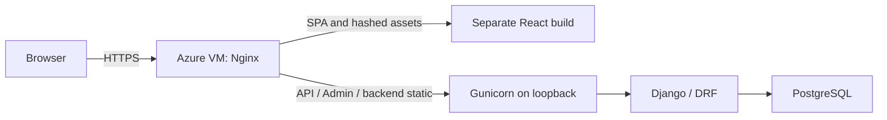
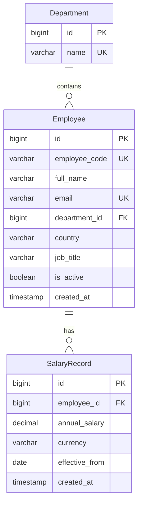

# Database and Admin — Phase 2

The sections below record incremental decisions. Final deployment topology:

The Azure VM configuration is prepared and locally verified; public deployment
is pending target/SSH/domain/database details. See [Azure deployment](azure-vm.md).

The backend has exactly three business models, using Django ORM and PostgreSQL.
Django's built-in auth, session, and Admin tables are unchanged.

## Constraints and validation

Department names, employee codes, employee emails, and employee/effective-date
pairs are unique in PostgreSQL. These use the database's normal case-sensitive
string equality. Salaries are positive `Decimal(14, 2)` amounts (at most
999,999,999,999.99). Check constraints restrict employee countries and stored
currencies to the supported MVP values. Foreign keys are indexed by Django;
the composite salary uniqueness constraint also indexes employee and date.
Both foreign keys use `PROTECT`: departments with employees and employees with
salary history cannot be deleted via ORM. Admin disables employee deletion.

`employees/countries.py` is the shared mapping: IN/INR, US/USD, GB/GBP, DE/EUR,
SG/SGD. Employee model validation rejects country transfers. Salary model
validation derives currency when omitted, rejects country/currency mismatches,
checks monetary precision and positivity, disallows future dates, and requires
new records to follow the latest effective date. Currency accepts blank form
input so validation can derive it; the database rejects blank stored currencies.

As with standard Django models, `save()`, bulk operations, and QuerySet updates
do **not** call `full_clean()`. Trusted ORM callers must validate explicitly.
Database constraints enforce local row invariants; cross-table currency matching,
country immutability, and chronological dates are application validation rules.
No triggers or extra business models are introduced.

## Admin workflow

Use Django's existing staff login and model permissions. A superuser can:

1. Create a department.
2. Add an employee with exactly one required initial salary inline; choose an
   effective date on or before today. Currency derives from the employee country.
3. Edit employee profile fields or deactivate them; country is read-only.
4. View salary history in the employee page or the Salary records list, newest
   effective date first. Existing salary rows cannot be added, edited, or deleted
   through these Admin pages, including by superusers.

Staff creating employees need both employee-add and salary-add permissions;
this prevents a missing inline permission from allowing salary-free employees.

Django Admin's change-form transaction covers the employee and initial salary
insert. Invalid inline input creates neither record. A failed salary write rolls
back the employee. The exactly-one initial salary rule is enforced at this write
boundary; a foreign key cannot by itself require a parent to have a child.
The relationship is shown as zero-or-many in the schema to reflect that physical
constraint. Trusted direct ORM callers can still stage employees without salaries.

## Current salary and phase boundaries

There is no `effective_to` and no duplicated current-salary field. Current salary
is the latest salary record effective on or before the reporting date. This phase
stores and displays history only; current-salary API queries and reporting come
in later phases. Salary revision operations with employee row locking and
concurrency tests belong to Phase 4; Admin deliberately exposes no revision path.
New model validation alone is not a concurrency-safe revision operation.

The initial migrations create only new business tables, leaving Phase 1 endpoints,
auth tables, and environment configuration intact. Apply with `migrate` and check
for pending migration changes before release. No REST endpoints, seed command,
analytics, or frontend were added in this phase.

## Phase 3: Employee APIs

The existing schema and Admin remain unchanged. `employees/serializers.py`
validates employee input; its create method inserts the employee and initial
SalaryRecord in one atomic transaction. Initial salary date is today, and currency
comes from the shared country mapping. The profile serializer exposes country
and annual salary as read-only. No revision or history endpoints are added.

`employees/views.py` uses DRF's generic list/viewset mixins, existing staff-only
session authentication, and CSRF protection. Department listing is an unpaginated
alphabetical lookup; employee listing has fixed 50-record server-side pages.
Validated department/country/status filters combine with DRF search. Employee
queries join the department and use two correlated scalar subqueries for the
latest effective salary amount and currency. A page requires one count and one
data query, independent of page length, excluding session/authentication queries.
The existing employee/date unique index supports salary lookups.

The API contract is documented in `docs/api.md` and generated OpenAPI documentation.
Documentation stays public at the user's request; business data stays staff-only.
Migrations are unchanged because this phase adds only API behavior.

## Phase 4: Salary revisions and history

`compensation/services.py` owns the small `revise_salary` operation. Inside
`transaction.atomic`, it loads and locks the employee with `select_for_update`,
requires an existing initial salary, derives currency from country, and calls
the existing SalaryRecord model validation before inserting a new record.
Model validation reads the latest salary while the employee lock is held, so
date validation happens after any competing revision commits. The database's
employee/effective-date uniqueness and positive-amount constraints remain a
second line of enforcement. No existing salary row is updated.

The lock serializes revision calls per employee, including requests with different
dates. A waiting request is rejected if its date is no longer later than the
committed latest salary. A failed validation or write rolls back the transaction.
Trusted bulk/ORM writers still must enforce their own validation and locking;
the service does not introduce triggers or change standard Django model behavior.

`compensation/views.py` exposes only history GET and revision POST at the nested
employee URL. The input serializer accepts amount/date; the output serializer is
read-only. Existing session/staff/CSRF defaults are preserved. History is an
unpaginated, newest-first array for one employee, using two queries including
the parent existence check. Admin mutation restrictions and employee profile
PATCH restrictions remain unchanged. No schema migration is needed.

TransactionTestCase tests use independent PostgreSQL connections and synchronization
events. One test verifies same-date revisions create exactly one new record;
another checks `pg_blocking_pids` to prove a waiting revision is blocked by the
first transaction, then verifies it rejects a stale date after the first commits.
The rollback test forces an error after a real insert and verifies no new history
remains. These checks do not simulate row locks with mocks or use SQLite.

## Phase 5: Country compensation analytics

The three GET endpoints reuse existing session/staff permissions. Their required
country filter is validated before database access. `compensation/analytics.py`
defines a shared current-salary queryset and five fixed salary bands per country;
the views and response serializers live in dedicated analytics modules within
the existing compensation app. No business models or runtime services were added.

The queryset selects one SalaryRecord per employee via a correlated latest-ID
subquery, with effective date no later than today. The outer query restricts
active employees, selected country, and its mapped currency. Currency filtering
is intentionally outside the latest-record subquery: a malformed latest currency
cannot cause fallback to a superseded salary. Missing effective salaries are
excluded from both headcount and monetary aggregates.

Overview uses Count/Avg/Sum/Min/Max in one query. Departments use database grouping,
and distribution uses five filtered Counts in a single aggregation query. Python
only formats the fixed five-band metadata and aggregate response. It never loads
all employee salaries for summation or bucketing. Default model ordering is
cleared before grouping; department results explicitly order by department name.
The existing employee/effective-date unique index supports latest-record lookup.

Each endpoint executes one data query, excluding authentication. Read-only tests
verify that count and the SQL aggregation, as well as current-salary selection,
country isolation, empty datasets, exact band boundaries, large totals, and
decimal half-up output rounding. Aggregates retain database decimal precision;
serializers round only the response to two decimal places. Empty sums are zero;
empty average/minimum/maximum remain null. Response totals allow 24 digits to
accommodate compensation across 10,000 employees. No migrations are required.

## Phase 6: Reproducible seed command

`employees/management/commands/seed_employees.py` adds an offline Django command,
using pinned Faker and a per-employee Random instance. Seed/index identities keep
codes, emails, names, country, department, role, money, and effective dates stable
when count changes or earlier employees already exist. A fixed country cycle
matches the suggested 40/25/15/10/10 percent split at 10,000 employees. Fixed past
effective dates avoid date-dependent output. Faker instances are local to the
command; it does not reseed application-wide random state.

All writes are atomic. Existing matching code/email pairs are skipped; collisions
abort and roll back rather than overwriting profiles or salary history. Memory
and SQL parameter lists are bounded by 500-employee batches. Employee bulk inserts
return PostgreSQL primary keys, then initial/revision salaries are bulk inserted
with those foreign keys. This avoids a query per generated record. Six department
names and small role lists provide readable synthetic data without new models.

The command deliberately uses bulk insertion with controlled values rather than
calling `full_clean` for every record. Tests verify generated field values,
currencies, dates, salary history, full 10,000-row counts, query budgets, rollback,
repeatability, and API compatibility. Database constraints remain active. Seeded
data is fictional; no employee data is fetched externally. Detailed behavior and
the distinction between business reproducibility and timestamps/IDs are documented
in `docs/seed-data.md`. Existing models, migrations, and API contracts are unchanged.

## Phase 7: Sessions and backend release

The built-in User model and database session engine are retained. Public
`/api/csrf/` bootstraps anonymous CSRF cookies/tokens. Login uses Django
authenticate/login and an explicit `csrf_protect` dispatch decorator: DRF's
normal SessionAuthentication alone does not check anonymous login CSRF. Successful
login rotates session and CSRF keys and returns only safe identity plus the fresh
token. Staff/active checks precede login. Login failures do not disclose which
credential or account policy failed. Auth responses are never cached.

Business APIs and `/api/me/` retain staff-only authorization. Logout permits an
authenticated user to clear its own session and uses normal session CSRF checks.
Session cookies are HttpOnly/SameSite=Lax with an eight-hour lifetime; production
session and CSRF cookies are Secure. Explicit tests exercise origin checks,
anonymous login CSRF, key rotation, real session access, permission revocation,
cookie attributes, and server-session invalidation.

The interactive `create_hr_user` command uses Django field/password validation,
password hashing, and an atomic insert. It creates staff without superuser or
Admin model-management privileges and never changes an existing account. Passwords
are not command-line arguments or logged output.

Root `gunicorn.conf.py` supplies backend working directory, environment-driven
port/worker count, timeout, and console logging. Existing WhiteNoise/manifest
storage remains intact and independent of React. Only public database readiness
is exempt from HTTPS redirects so hosting probes receive genuine readiness
status. No business route is exempt. Deployment uses one application plus
PostgreSQL; `docs/backend-release.md` records exact release/provisioning commands.
No model migration, extra service, authentication dependency, or frontend is added.

## Phase 8: Independent React/Vite client

The user explicitly chose separate frontend hosting and unchanged backend source,
overriding the master prompt's combined static-serving choice. `frontend/` owns its
package manifest, lockfile, Vite configuration, source, tests, and static output.
No backend model, route, settings, migration, or dependency changed in this phase.

BrowserRouter provides login, protected Dashboard/Employees placeholders, and a
shared responsive layout. An auth context checks `/api/me/` on startup and keeps
identity only in memory. Service outages have retry UI rather than masquerading
as invalid credentials. Invalid staff sessions redirect to login. No business
screen or reporting feature is implemented ahead of its phase.

The one native Fetch client sends same-origin cookies, obtains a fresh CSRF
bootstrap for each write, sets one normalized header, handles JSON/HTML errors
and 204 responses, and preserves cancellation. Refreshing CSRF at write boundaries
adds a small request cost while avoiding stale-token coordination across login
and multiple tabs. Logout only clears local identity after backend success or
confirmed expiration; no credentials/tokens are stored in browser storage.

Vite's local dev/preview proxy preserves the browser Host/Origin pair. For separate
production hosting, the frontend host proxies `/api/*` to Django and serves the
SPA HTML for application routes. The existing backend environment settings permit
the trusted frontend origin/host without adding CORS or changing backend code.
Static assets are built independently and never installed into Django's static
root. Node API-client tests and Chromium integration tests verify the contract.

## Phase 9: Employee management client

The existing protected routes now render employee listing and `/employees/:id`
details. A small employee API module delegates cookies, CSRF, errors, and
cancellation to the existing Fetch client. A shared department lookup hook
supports loading/retry. No backend route, schema, model, or dependency changes
are needed.

The listing sends search/filter/page query parameters to the fixed 50-record
backend paginator, omitting empty filters. URL parameters retain navigation and
refresh state; filter changes reset the page. AbortControllers prevent obsolete
requests from replacing current results. A shared explicit Material UI dialog
handles creation/profile editing, server field errors, and pending controls;
there is no dynamic form framework or additional state library.

Initial salary is a decimal string with country-derived currency. Profile PATCH
omits country, currency, and salary. Details show the current salary supplied by
the employee endpoint. Confirmed status changes preserve the employee and salary
history. Successful changes refetch server state. Salary history/revision and
analytics UI remain outside this phase. Frontend hosting remains independent,
with the same-origin API proxy and SPA fallback documented in frontend/README.md.

## Phase 10: Salary management client

Employee details retain their current salary card and embed a small SalaryHistory
component. It GETs the existing nested salary endpoint with cancellation, renders
backend ordering, and owns independent loading/empty/retry states. A dedicated
Material UI dialog POSTs only annual_salary (decimal string) and effective_from;
currency stays read-only, with derivation and validation owned by Django.

Client checks cover positive amounts, existing precision/range, valid calendar
dates, strictly increasing effective dates, and the UTC date boundary matching
the backend. These checks improve feedback without replacing server validation:
a stale-history/concurrent-write rejection remains a visible field error. A
pending ref guards submission synchronously; controls and dismissal are disabled
until the request finishes. Writes are never automatically retried.

A successful revision reloads employee details through the existing refresh path,
remounting history and fetching both current salary and history from the server.
No optimistic salary mutation, cache library, new backend endpoint, schema,
dependency, or analytics screen is introduced. Historical rows are read-only.

## Phase 11: Compensation dashboard client

DashboardPage replaces the last placeholder while retaining protected routing and
the existing layout. Country is a URL parameter (default IN), selected from the
same five-country mapping as employee forms. analyticsApi loads the existing
three reports concurrently with one shared cancellation signal and checks their
currencies against that selection. A complete successful report set replaces
loading state; failures expose retry without fabricated zero/partial summaries.
Aborted/stale responses cannot restore another country's data.

Material UI cards display server-returned employee count and salary aggregates.
CompensationCharts uses Recharts for average salary by department and employee
count by backend salary band; animations are disabled. Exact data tables are
available under native disclosure controls. Financial strings remain unchanged
for display/tooltips; numeric copies serve only chart coordinates. No employee
fetch, frontend aggregation, currency conversion, report builder, or cache is added.

Recharts and its matching react-is peer are pinned. Responsive chart sizing follows
[the official sizing guide](https://recharts.github.io/en-US/guide/sizes/); the
existing Vite vendor chunks gain a charts chunk to keep the application bundle
bounded. Chart values are reloaded on country changes, manual refresh, or route
remount after a salary revision. Empty countries show zero count/total, null
statistics as unavailable, and explanatory text in place of charts. Separate
frontend hosting, backend source, database schema, and APIs remain unchanged.

## Phase 12: Release integration

The selected Azure VM topology uses systemd-managed Gunicorn on loopback and
Nginx as the HTTPS entry point and separate React static server. No app feature,
model, migration, dependency, authentication mechanism, or backend static-serving
behavior changed. The service and Nginx files are reviewable templates, not proof
of a public deployment. Their local substitutes passed systemd/Nginx syntax
checks and actual HTTPS proxy/static/session/API checks.

The browser runner provisions random-prefix test accounts and dated employee
fixtures, runs the existing scenarios against both frontend servers, optionally
records a real browser-only demo, and removes only its owned rows/sessions. It
does not seed/reset databases or store credentials in source. Logs/videos are
ignored generated artifacts. The final assessment matrix and Azure access/URL
blockers are explicit in submission.md; final sending remains user-authorized.
