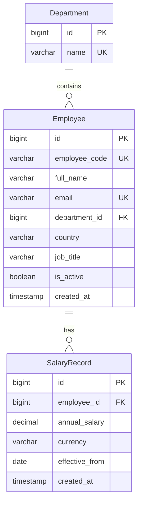

# Database and Admin — Phase 2

The backend has exactly three business models, using Django ORM and PostgreSQL.
Django's built-in auth, session, and Admin tables are unchanged.

## Constraints and validation

Department names, employee codes, employee emails, and employee/effective-date
pairs are unique in PostgreSQL. These use the database's normal case-sensitive
string equality. Salaries are positive `Decimal(14, 2)` amounts (at most
999,999,999,999.99). Check constraints restrict employee countries and stored
currencies to the supported MVP values. Foreign keys are indexed by Django;
the composite salary uniqueness constraint also indexes employee and date.
Both foreign keys use `PROTECT`: departments with employees and employees with
salary history cannot be deleted via ORM. Admin disables employee deletion.

`employees/countries.py` is the shared mapping: IN/INR, US/USD, GB/GBP, DE/EUR,
SG/SGD. Employee model validation rejects country transfers. Salary model
validation derives currency when omitted, rejects country/currency mismatches,
checks monetary precision and positivity, disallows future dates, and requires
new records to follow the latest effective date. Currency accepts blank form
input so validation can derive it; the database rejects blank stored currencies.

As with standard Django models, `save()`, bulk operations, and QuerySet updates
do **not** call `full_clean()`. Trusted ORM callers must validate explicitly.
Database constraints enforce local row invariants; cross-table currency matching,
country immutability, and chronological dates are application validation rules.
No triggers or extra business models are introduced.

## Admin workflow

Use Django's existing staff login and model permissions. A superuser can:

1. Create a department.
2. Add an employee with exactly one required initial salary inline; choose an
   effective date on or before today. Currency derives from the employee country.
3. Edit employee profile fields or deactivate them; country is read-only.
4. View salary history in the employee page or the Salary records list, newest
   effective date first. Existing salary rows cannot be added, edited, or deleted
   through these Admin pages, including by superusers.

Staff creating employees need both employee-add and salary-add permissions;
this prevents a missing inline permission from allowing salary-free employees.

Django Admin's change-form transaction covers the employee and initial salary
insert. Invalid inline input creates neither record. A failed salary write rolls
back the employee. The exactly-one initial salary rule is enforced at this write
boundary; a foreign key cannot by itself require a parent to have a child.
The relationship is shown as zero-or-many in the schema to reflect that physical
constraint. Trusted direct ORM callers can still stage employees without salaries.

## Current salary and phase boundaries

There is no `effective_to` and no duplicated current-salary field. Current salary
is the latest salary record effective on or before the reporting date. This phase
stores and displays history only; current-salary API queries and reporting come
in later phases. Salary revision operations with employee row locking and
concurrency tests belong to Phase 4; Admin deliberately exposes no revision path.
New model validation alone is not a concurrency-safe revision operation.

The initial migrations create only new business tables, leaving Phase 1 endpoints,
auth tables, and environment configuration intact. Apply with `migrate` and check
for pending migration changes before release. No REST endpoints, seed command,
analytics, or frontend were added in this phase.
